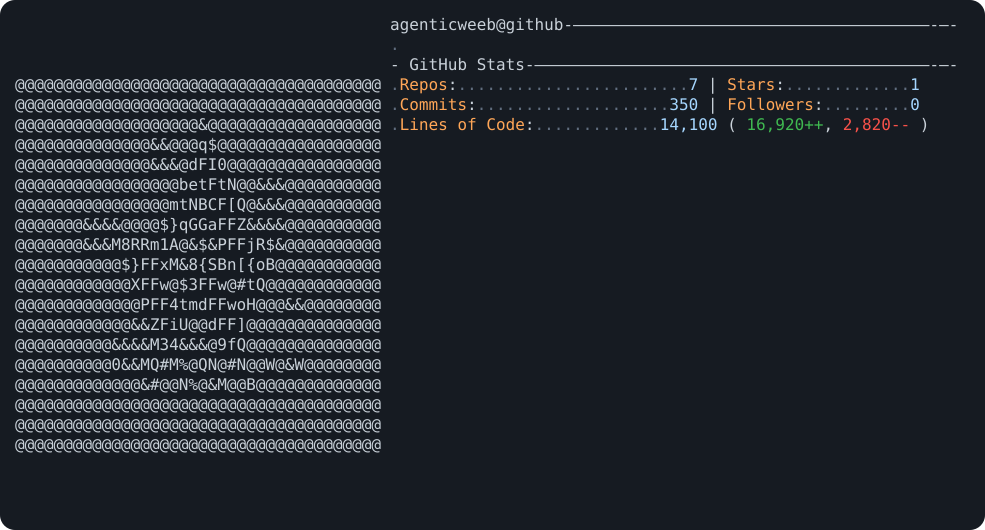

<div align="center">

<picture>
  <source media="(prefers-color-scheme: dark)" srcset="dark_mode.svg">
  <source media="(prefers-color-scheme: light)" srcset="light_mode.svg">
  
</picture>

# Terry (@agenticweeb)
### Full-Stack AI Application Engineer & Prompt Systems Architect

[](https://aniwatchorder.cc)
[](https://x.com/agenticweeb)
[](mailto:angazadesk@zohomail.com)
[](https://github.com/agenticweeb)

<p align="center">
  <b>Building robust, zero-hallucination AI products, streaming LLM gateways, and modern full-stack web applications.</b><br/>
  <i>Specializing in Next.js 16, React 19, TypeScript, Python, multi-LLM failover architectures, and empirical prompt evaluation.</i>
</p>

[Featured Systems](#-featured-production-systems) · [Engineering Principles](#-core-specializations) · [Tech Stack](#-technical-stack) · [Services & Work](#-services--collaboration) · [Contact](#-get-in-touch)

</div>

---

## ⚡ Core Specializations

* **Production AI Architectures:** Full-stack systems engineered with Next.js 16 App Router, Turbopack, React 19, TypeScript, and Tailwind CSS v4.
* **Resilient Multi-LLM Gateways:** Zero-downtime inference pipelines utilizing Groq, Google Gemini, and OpenRouter with automatic graceful failovers, exponential backoff, and SSE (Server-Sent Events) streaming.
* **Empirical Prompt Engineering & Evals:** Rigorous, test-driven evaluation harnesses measuring accuracy across model species (Thinkers vs. Direct Speakers), prompt injection defenses (delimiters, sandwich prompts), and strict structured JSON guarantees.
* **Zero-Hallucination Grounding:** Real-world graph traversal and entity resolution (e.g., AniList GraphQL) where models order and synthesize data without inventing facts.
* **Privacy-First & Local LLMs:** Secure, on-device parsing pipelines utilizing Ollama (`llama3.2`) and BYOK (Bring-Your-Own-Key) stateless architectures where user documents never persist.

---

## 🚀 Featured Production Systems

### 1. [MyAniWatchOrder](https://github.com/agenticweeb/myaniwatchorder) — [Live Site (aniwatchorder.cc)](https://aniwatchorder.cc)
> **AI-Powered Anime Watch Order Engine & Timeline Graph Solver**
* **The Problem:** Complex anime franchises (Fate, Monogatari, Gundam) span dozens of spin-offs, movies, and confusing timelines.
* **The Solution:** A zero-hallucination engine that traverses AniList’s GraphQL relation graph (BFS) and uses a multi-LLM failover chain (Groq → Gemini) to generate spoiler-safe, 4-tier timelines (Essential, Recommended, Optional, Skip) with real pacing math.
* **Stack:** Next.js 16, React 19, TypeScript, Vercel AI SDK, Upstash Redis, TanStack Query, Zustand, Tailwind CSS v4.

---

### 2. [Switchboard](https://github.com/agenticweeb/ai-learning-journey)
> **Universal OpenAI-Compatible LLM Learning Instrument & Wire Inspector**
* **The Problem:** LLM API integration is often opaque—developers struggle to debug streaming frames, CORS constraints, rate limits, and wire-level payloads.
* **The Solution:** A dual web app (Next.js 16 / React 19) and Python CLI (`switchboard_cli`) demonstrating BYOK architecture, safe browser-direct calls, fixed-allowlist relay, SSE frame parser, wire-level X-ray telemetry, and provider comparisons.
* **Stack:** Next.js 16 App Router, React 19, TypeScript, Python 3.11+, `openai`, `pytest`, Tailwind CSS.

---

### 3. [Prompt Engineering Lab & Evaluation Harness](https://github.com/agenticweeb/ai-learning-journey)
> **Empirical, Cached Experiment Harness for Model Evaluation**
* **The Goal:** Move beyond "vibe-coding" to measurable prompt science across model species (Thinkers like GPT-OSS vs. Direct Speakers like Qwen and Allam).
* **The Architecture:** Handcrafted test runner (`lab.py`) with response caching, automated scoring rubrics, difficulty engineering (`ex2_hard.py`), instruction-conflict probes, and prompt injection defense benchmarks (naive vs. delimited vs. sandwich).
* **Stack:** Python, OpenAI-compatible SDKs, custom caching layer, automated scoring rubrics.

---

### 4. AngazaDesk Platform & Digital Architecture
> **Enterprise Digital Architecture & Automated Revenue Engine**
* **The Solution:** High-performance business platform featuring Generative Engine Optimization (GEO) for AI search visibility, Sanity CMS headless content studio, dynamic multi-currency pricing engine (USD, EUR, GBP, KES), sliding-window rate limiters, multi-LLM failover, and automated Treasury OS.
* **Stack:** Next.js 16, React 19, TypeScript, Sanity CMS, Framer Motion, Groq, Gemini, Stripe & M-Pesa STK integration.

---

### 5. Mobile Money Statement Engine (M-Pesa Offline Cleaner)
> **100% Offline, Privacy-Preserving Financial Statement Processor**
* **The Solution:** Parses raw mobile transaction SMS data into structured, reconciled CSV ledgers with categorical accounting breakdowns. Features an optional local LLM fallback using Ollama (`llama3.2`) ensuring zero financial data ever leaves the local machine.
* **Stack:** Python, regular expressions, local Ollama API, CSV/Excel export pipelines.

---

## 🛠️ Technical Stack

```
Frontend    │ Next.js 16 (App Router), React 19, TypeScript, Tailwind CSS v4, Framer Motion
AI & LLMs   │ Groq, Google Gemini, OpenRouter, Ollama (Local), Vercel AI SDK, Prompt Evals
Backend     │ Node.js, Python, Edge Handlers, Serverless Functions, REST & GraphQL APIs
Database    │ Upstash Redis, Supabase (Postgres), Sanity CMS Headless Content Lake
DevOps      │ Git, GitHub Actions, Vercel Edge Network, Linux/Windows environments
Testing     │ Pytest, automated scoring rubrics, benchmark hold-out splits
```

---

## 📈 Activity & Stats

<div align="center">
  
  
</div>

---

## 💼 Services & Collaboration

I partner with startups, product teams, and founders looking to build and deploy high-leverage AI products:

* **Production AI Application Development:** Taking an AI concept from idea to a high-speed, deployed Next.js/React web application.
* **LLM Gateway & Streaming Infrastructure:** Implementing robust SSE streaming, rate-limit backoff, multi-provider failover chains, and token tracking.
* **Prompt Optimization & Evaluation Pipelines:** Benchmarking prompts on rigorous test suites, eliminating hallucinations, and hardening systems against prompt injection.
* **Full-Stack Web Engineering:** Building fast, responsive, and SEO/GEO-optimized modern web applications.

---

## 📬 Get in Touch

* **Email:** [angazadesk@zohomail.com](mailto:angazadesk@zohomail.com)
* **X (Twitter):** [@agenticweeb](https://x.com/agenticweeb)
* **GitHub:** [github.com/agenticweeb](https://github.com/agenticweeb)

<div align="center">
<sub>Built with precision · Grounded in data · Shipped with impact</sub>
</div>
